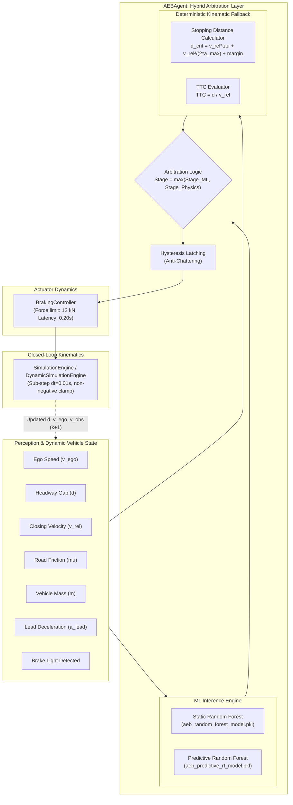

# Automatic Emergency Braking (AEB) using Machine Learning and Physics-Based Collision Prevention
## BTP Interim Evaluation Documentation & Project Master Guide

---

## 1. Project Objective & Problem Statement

Autonomous Emergency Braking (AEB) is an essential Active Safety System in modern Advanced Driver Assistance Systems (ADAS). While standard rules-based systems rely purely on instantaneous kinematic thresholds (such as Time-to-Collision), they often struggle to balance sensitivity against nuisance false alarms under varying vehicle weights, road friction variations, and sudden lead-vehicle maneuvers. Conversely, pure Machine Learning (ML) classifiers can suffer from out-of-distribution false negatives or reaction latency when trained solely on static state snapshots.

### Primary Objectives of this BTP Project:
1. **Design and implement an integrated Hybrid AEB Architecture** combining statistical collision-risk prediction (Random Forest) with a deterministic, physically justified kinematic safety fallback.
2. **Model realistic vehicle dynamics**, including actuator response latency ($\tau = 0.20\text{s}$), tire-road friction saturation ($a_{\text{max}} = \min(F_{\text{brake}} / m, \mu g)$), non-linear closing velocity, and sub-step numerical integration.
3. **Simulate complex dynamic lead-vehicle maneuvers**, including gradual slowing, sudden hard braking ($-6\text{ m/s}^2$), emergency stops ($-9\text{ m/s}^2$), and adverse weather conditions (wet asphalt, icy roads).
4. **Demonstrate and quantify the independent predictive contribution of Machine Learning** over physics-only rules by incorporating dynamic perception features (lead deceleration, brake-light intent, projected TTC, and relative acceleration).
5. **Maintain strict scientific rigor**: zero data leakage between training and testing, bit-exact reproducibility across 500-scenario benchmarks, and 100% test pass rate across 58 automated unit tests.

---

## 2. System Architecture

The project is structured into three cooperating layers: **Perception / ML Inference**, **Control Arbitration**, and **Kinematic Simulation**.



### Core Architecture Components:
- **`AEBAgent` ([`aeb_agent.py`](file:///C:/Users/udaya/OneDrive/Desktop/BTP/aeb_agent.py)):** Coordinates perception input, evaluates Random Forest collision probability, computes stopping distances, arbitrates stage escalation, and latches stages using hysteresis.
- **`BrakingController` ([`braking_controller.py`](file:///C:/Users/udaya/OneDrive/Desktop/BTP/braking_controller.py)):** Simulates physical hydraulic brake line delay (0.20s ramp-up) and clamps deceleration to the physical traction limit:
  $$a_{\text{available}} = \min\left(\frac{F_{\text{max}}}{m},\, \mu \cdot g\right)$$
- **`SimulationEngine` ([`simulation_engine.py`](file:///C:/Users/udaya/OneDrive/Desktop/BTP/simulation_engine.py)):** 1D longitudinal numerical integration engine ($\Delta t = 0.01\text{s}$) modeling vehicle and obstacle displacement until safe stop or impact.
- **`DynamicSimulationEngine` ([`dynamic_simulation_engine.py`](file:///C:/Users/udaya/OneDrive/Desktop/BTP/dynamic_simulation_engine.py)):** Advanced closed-loop engine supporting active lead-vehicle acceleration/deceleration profiles, fractional sub-step velocity clamping to zero, and non-negative velocity enforcement.

---

## 3. Dataset Generation & ML Models Developed

### A. Datasets Summary
| Dataset File | Records | Primary Features | Seed / Source | Purpose |
| :--- | :---: | :--- | :---: | :--- |
| **`aeb_dataset.csv`** | 9,999 | $v_{\text{ego}}, m, d, v_{\text{rel}}, \mu$, road, weather | Synthesized | Original production training dataset |
| **`aeb_new_dataset.csv`** | 1,000 | $v_{\text{ego}}, m, d, v_{\text{rel}}, \mu$, road, weather | Synthesized | Independent baseline validation test set |
| **`aeb_predictive_dataset.csv`** | 36,358 | Static features + $a_{\text{lead}}$, brake light, $a_{\text{rel}}$, $\text{TTC}_{\text{proj}}$, $\hat{\mu}_{\text{noisy}}$ | $seed = 101$ | Dedicated dynamic perception training dataset |

### B. Models Developed
| Model File | Algorithm | Features | Training Accuracy | ROC-AUC | Key Advantage |
| :--- | :--- | :--- | :---: | :---: | :--- |
| **`aeb_random_forest_model.pkl`** | Random Forest (100 trees) | 7 static features | 99.50% | 99.98% | Fast baseline classification of static hazard snapshots |
| **`aeb_predictive_rf_model.pkl`** | Random Forest (100 trees, max depth 12) | 16 dynamic perception features | 99.53% | 99.99% | Early detection of lead braking intent prior to closing velocity accumulation |

### C. Predictive Feature Ranking:
1. `projected_ttc` (**30.31%**): Acceleration-corrected time-to-collision
2. `time_to_collision` (**20.01%**): Classical $d / v_{\text{rel}}$ ratio
3. `lead_deceleration` (**10.10%**): Active rate of lead slowing
4. `relative_speed` (**8.29%**): Radar Doppler closing rate
5. `relative_acceleration` (**7.69%**): Differential acceleration $a_{\text{ego}} - a_{\text{lead}}$
6. `friction_estimate` (**5.73%**): Onboard traction coefficient under sensor noise
7. `brake_light_detected` (**1.21%**): Optical perception confirmation of driver intent

---

## 4. Physics-Based Braking Logic

The physics safety fallback prevents ML false negatives by calculating the theoretical stopping distance required to bring the closing speed to zero:

$$a_{\text{max}} = \min\left(\frac{F_{\text{brake\_max}}}{m},\, \mu \cdot g\right)$$

### 1. Critical Stopping Distance ($d_{\text{crit}}$) — Triggers `FULL` Braking:
$$d_{\text{crit}} = \left(v_{\text{rel}} \cdot \tau\right) + \frac{v_{\text{rel}}^2}{2 \cdot a_{\text{max}}} + d_{\text{margin\_crit}}$$
- $\tau = 0.20\text{s}$ (hydraulic actuator delay)
- $d_{\text{margin\_crit}} = 1.0\text{m}$ (safety bumper buffer)

### 2. Warning Stopping Distance ($d_{\text{warn}}$) — Triggers `PARTIAL` Braking (40% effort):
$$d_{\text{warn}} = \left(v_{\text{rel}} \cdot \tau\right) + \frac{v_{\text{rel}}^2}{2 \cdot (0.40 \cdot a_{\text{max}})} + d_{\text{margin\_warn}}$$
- $d_{\text{margin\_warn}} = 4.0\text{m}$ (comfort and driver handover margin)

### 3. Arbitration Rule:
$$\text{Decision} = \max\left(\text{Decision}_{\text{ML}},\, \text{Decision}_{\text{Physics}}\right)$$
The physics fallback acts as an inviolable safety envelope: a low ML probability cannot suppress braking when $d \le d_{\text{crit}}$ or $\text{TTC} \le 1.4\text{s}$.

---

## 5. Experimental Evolution & Benchmark Results

The system was evaluated through three progressive experimental phases across hundreds of scenarios:

```
  Phase 1: Static Obstacles (500 Scenarios)
  [No AEB: 435 Crashes]  --->  [ML-Only: 316 Crashes]  --->  [Physics/Hybrid: 235 Crashes]
  
  Phase 2: Dynamic Lead Braking (500 Scenarios)
  [No AEB: 385 Crashes]  --->  [ML-Only: 320 Crashes]  --->  [Physics/Hybrid: 238 Crashes]
  
  Phase 3: Predictive ML Perception (500 Scenarios)
  [No AEB: 385 Crashes]  --->  [Physics-Only: 238 Crashes]  --->  [Predictive Hybrid: 87 Crashes]
                                                                  (151 Additional Crashes Saved!)
```

### Master Comparison Table (500 Dynamic Scenarios, Seed=42)

| Metric | 1. No AEB (Baseline) | 2. Static ML-Only | 3. Physics-Only | 4. Predictive ML-Only | 5. Predictive Hybrid (Ours) |
| :--- | :---: | :---: | :---: | :---: | :---: |
| **Total Scenarios** | 500 | 500 | 500 | 500 | 500 |
| **Collisions** | **385 / 500** | **320 / 500** | **238 / 500** | **88 / 500** | **87 / 500** |
| **Collision Rate** | 77.00% | 64.00% | 47.60% | 17.60% | **17.40%** |
| **Collisions Prevented** | 0 | 65 | 147 | 297 | **298** |
| **Collision Reduction vs Baseline** | 0.00% | 16.88% | 38.18% | 77.14% | **77.40%** |
| **Crashes Saved Over Physics-Only** | — | — | 0 | **+150 saved** | **+151 saved** |
| **Crash Reduction vs Physics-Only** | — | — | 0.00% | 63.03% | **63.45%** |
| **Avg Impact Closing Speed** | 51.86 km/h | 32.96 km/h | 28.75 km/h | 25.38 km/h | **25.51 km/h** |
| **Avg Minimum Headway Gap** | 8.56 m | 8.88 m | 9.85 m | 16.08 m | **16.17 m** |
| **Avg Braking Onset Latency ($t_{\text{brake}}$)** | N/A | 2.718 s | 2.194 s | 1.662 s | **1.656 s** |
| **Lead Time vs Physics-Only** | N/A | N/A | Baseline | +0.565 s | **+0.571 s earlier** |
| **False Braking in Safe Scenarios ($n=80$)** | N/A | **0 / 80 (0.0%)** | **0 / 80 (0.0%)** | **0 / 80 (0.0%)** | **0 / 80 (0.0%)** |

---

## 6. Curated List of Important Files to Demonstrate

### A. Production Core Modules (Preserved & Protected)
- [`aeb_agent.py`](file:///C:/Users/udaya/OneDrive/Desktop/BTP/aeb_agent.py): Core production AEB agent with ML inference and physics safety fallback.
- [`braking_controller.py`](file:///C:/Users/udaya/OneDrive/Desktop/BTP/braking_controller.py): Hydraulic brake force limiter, actuator delay, and stage transitions.
- [`simulation_engine.py`](file:///C:/Users/udaya/OneDrive/Desktop/BTP/simulation_engine.py): Longitudinal 1D simulation engine for static and moving obstacle verification.
- [`aeb_random_forest_model.pkl`](file:///C:/Users/udaya/OneDrive/Desktop/BTP/aeb_random_forest_model.pkl): Production Random Forest pipeline.

### B. Experimental Simulation & Predictive ML Modules
- [`dynamic_simulation_engine.py`](file:///C:/Users/udaya/OneDrive/Desktop/BTP/dynamic_simulation_engine.py): Dynamic simulation engine supporting lead vehicle acceleration/deceleration profiles.
- [`predictive_aeb_agent.py`](file:///C:/Users/udaya/OneDrive/Desktop/BTP/predictive_aeb_agent.py): Predictive AEB Agent implementing lead deceleration, brake-light perception, and projected TTC.
- [`predictive_aeb_model.py`](file:///C:/Users/udaya/OneDrive/Desktop/BTP/predictive_aeb_model.py): Pipeline training script and feature importance analyzer for predictive perception.
- [`aeb_predictive_rf_model.pkl`](file:///C:/Users/udaya/OneDrive/Desktop/BTP/aeb_predictive_rf_model.pkl): Trained predictive Random Forest classifier (99.53% accuracy).

### C. Experimental Benchmark Scripts & Result Datasets
- [`experiment_predictive_500.py`](file:///C:/Users/udaya/OneDrive/Desktop/BTP/experiment_predictive_500.py): Parallelized 500-scenario benchmark evaluating Predictive ML vs Physics-Only.
- [`aeb_predictive_500_comparison.csv`](file:///C:/Users/udaya/OneDrive/Desktop/BTP/aeb_predictive_500_comparison.csv): Complete results dataset across 500 dynamic test scenarios (seed=42).
- [`aeb_dynamic_500_comparison.csv`](file:///C:/Users/udaya/OneDrive/Desktop/BTP/aeb_dynamic_500_comparison.csv): Benchmark dataset for dynamic lead braking with static agents.
- [`aeb_4way_500_comparison.csv`](file:///C:/Users/udaya/OneDrive/Desktop/BTP/aeb_4way_500_comparison.csv): Benchmark dataset for 500 static obstacle scenarios.

### D. Automated Unit Tests (58 Tests across 8 Files)
- [`tests/test_predictive_aeb.py`](file:///C:/Users/udaya/OneDrive/Desktop/BTP/tests/test_predictive_aeb.py): Unit tests for predictive features, early triggering, and sensor noise robustness (7 tests).
- [`tests/test_dynamic_lead_braking.py`](file:///C:/Users/udaya/OneDrive/Desktop/BTP/tests/test_dynamic_lead_braking.py): Unit tests for dynamic acceleration/deceleration and zero-speed clamping (11 tests).
- [`tests/test_hybrid_aeb_agent.py`](file:///C:/Users/udaya/OneDrive/Desktop/BTP/tests/test_hybrid_aeb_agent.py): Tests for hybrid arbitration and physics fallback (10 tests).
- [`tests/test_simulation_engine.py`](file:///C:/Users/udaya/OneDrive/Desktop/BTP/tests/test_simulation_engine.py): Tests for kinematics and collision detection (7 tests).
- [`tests/test_braking_controller.py`](file:///C:/Users/udaya/OneDrive/Desktop/BTP/tests/test_braking_controller.py): Tests for multi-stage braking and actuator latency (7 tests).
- [`tests/test_kinematic_baseline.py`](file:///C:/Users/udaya/OneDrive/Desktop/BTP/tests/test_kinematic_baseline.py): Tests for pure kinematic safety baseline (5 tests).
- [`tests/test_aeb_agent.py`](file:///C:/Users/udaya/OneDrive/Desktop/BTP/tests/test_aeb_agent.py): Tests for baseline agent and hysteresis (5 tests).
- [`tests/test_baseline.py`](file:///C:/Users/udaya/OneDrive/Desktop/BTP/tests/test_baseline.py): Tests for dataset presence and model loading (2 tests).

### E. Interactive Dashboard
- [`aeb_dashboard/`](file:///C:/Users/udaya/OneDrive/Desktop/BTP/aeb_dashboard): React, Vite, and Tailwind CSS automotive technology dashboard.

---

## 7. How to Run Demonstrations & Verify Results

All scripts run out-of-the-box using Python 3.11:

### 1. Run Complete Automated Test Suite (58 Tests)
```powershell
py -3.11 -m pytest tests -v
```
*Expected Result:* `58 passed in ~45-50s (100% success rate)`

### 2. Run the Predictive AEB 500-Scenario Benchmark
```powershell
py -3.11 experiment_predictive_500.py
```
*Expected Result:* Runs on 12 CPU workers, completes in ~55s, prints the full statistical summary, and saves `aeb_predictive_500_comparison.csv`.

### 3. Run the Dynamic Lead-Vehicle 500-Scenario Benchmark
```powershell
py -3.11 experiment_dynamic_500.py
```
*Expected Result:* Completes in ~40-50s, generating `aeb_dynamic_500_comparison.csv`.

### 4. Run the Static 500-Scenario Four-Way Benchmark
```powershell
py -3.11 evaluate_hybrid_500_comparison.py
```
*Expected Result:* Evaluates 500 static scenarios, generating `aeb_4way_500_comparison.csv`.

### 5. Launch the Interactive Web Dashboard
```powershell
cd aeb_dashboard
npm run dev
```
*Expected Result:* Starts local web server on `http://127.0.0.1:5173/` for live visual demonstration.

---

## 8. Backup Verification

A complete, verified backup of the current project state has been created and preserved in two separate locations:
1. **Compressed Zip Archive:** [`btp_interim_backup_checkpoint.zip`](file:///C:/Users/udaya/OneDrive/Desktop/BTP/btp_interim_backup_checkpoint.zip) (2.83 MB, 74 archived files).
2. **Directory Mirror Backup:** `C:\Users\udaya\OneDrive\Desktop\BTP_INTERIM_BACKUP` (74 files).

---

## 9. Current Limitations & Future Work

### Current Limitations:
1. **1D Longitudinal Physics:** The simulation models 1D longitudinal displacement and tire slip. It does not model lateral steering evasive maneuvers, road camber, or vehicle roll/pitch suspension dynamics.
2. **Synthetic Sensor Perception:** Brake light detection and lead deceleration are modeled with simulated Gaussian noise and latency rather than processing raw camera image frames or FMCW radar point clouds.
3. **Obstacle Classes:** The current benchmark focuses on vehicle-to-vehicle rear-end collisions and does not yet include pedestrian crossing or vulnerable road user (VRU) cyclist trajectories.

### Planned Next Steps for Final BTP Submission:
1. **High-Fidelity 3D Simulation (CARLA / AirSim):** Port the verified Hybrid AEB arbitration algorithm to the open-source CARLA simulator to evaluate 3D camera/LiDAR sensor fusion in realistic urban street networks.
2. **Combined Steering & Braking (Autonomous Evasive Maneuver):** Implement automated lane change avoidance when braking distance alone is insufficient.
3. **Deep Learning Vision Front-End:** Integrate a lightweight CNN / Vision Transformer (e.g. YOLOv8-Nano) to detect tail-lamp illumination and classify VRUs from camera video streams.
4. **Hardware-in-the-Loop (HIL) Prototype:** Interface the Python AEB agent with a physical microcontroller (e.g., STM32 / Raspberry Pi) via CAN bus to demonstrate real-time response under actual embedded latency constraints.

